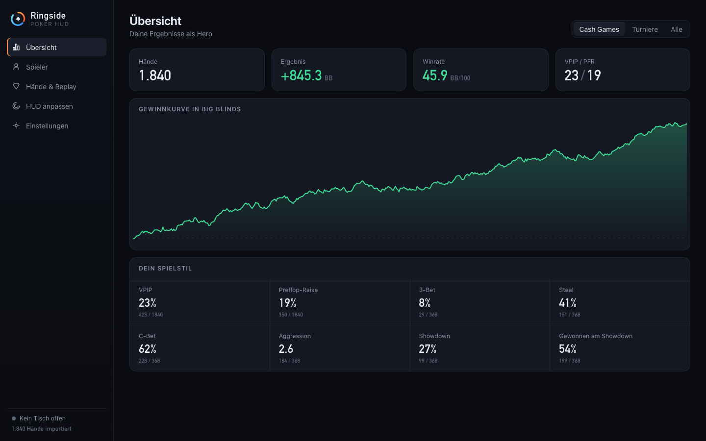
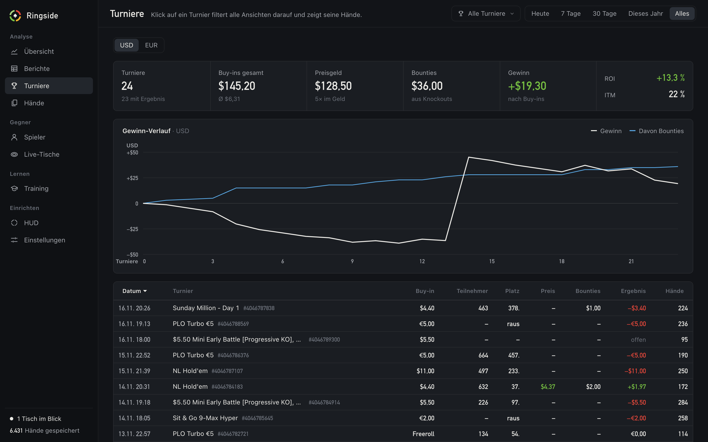
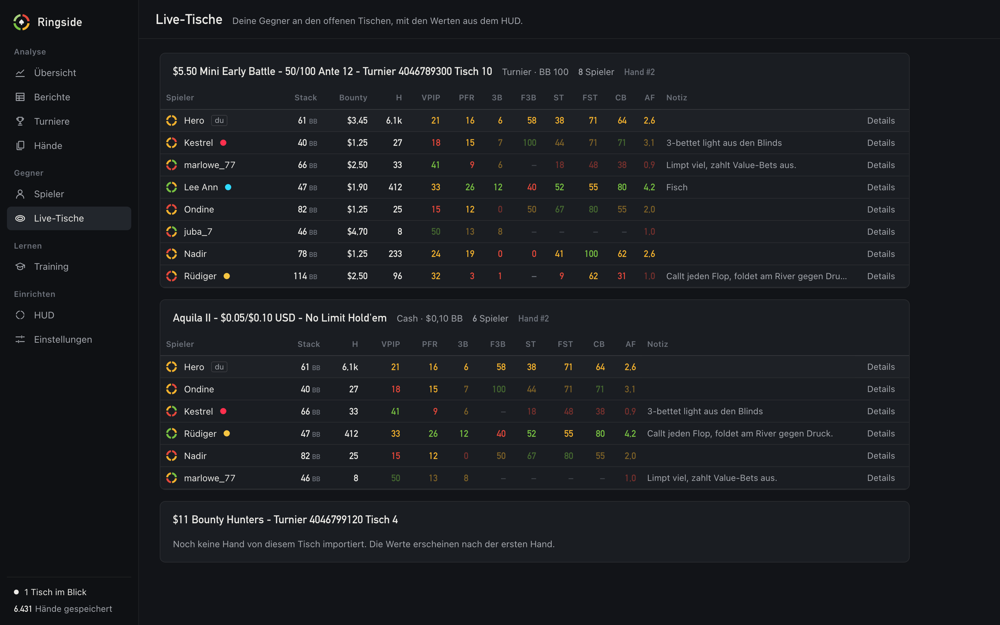
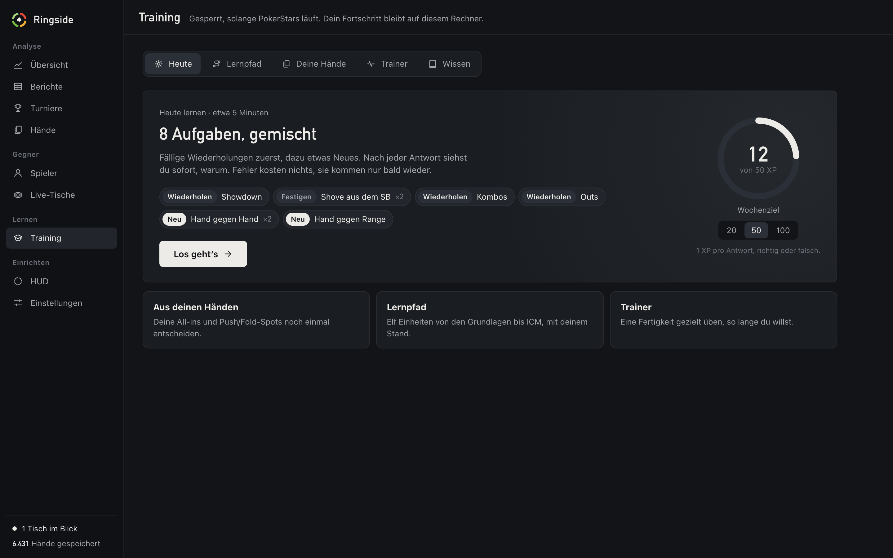
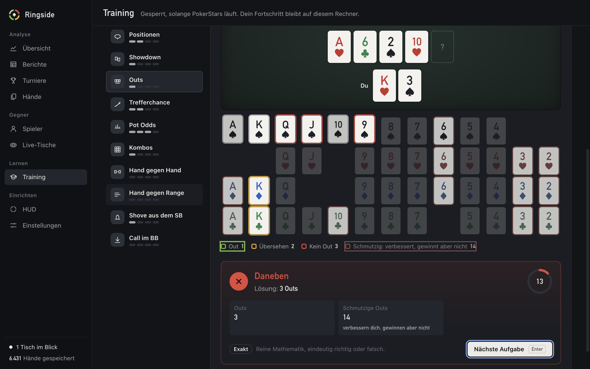
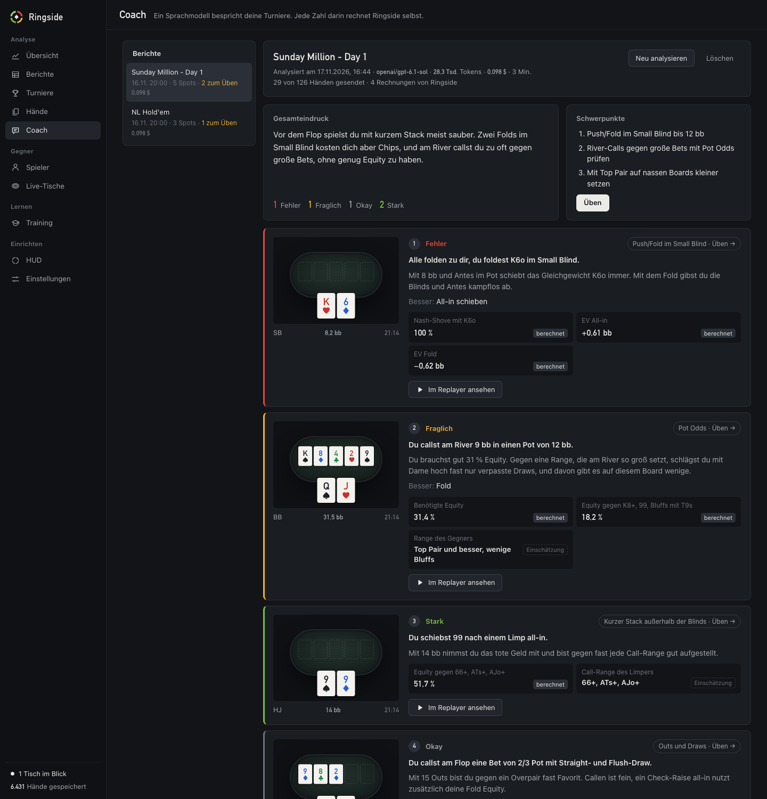
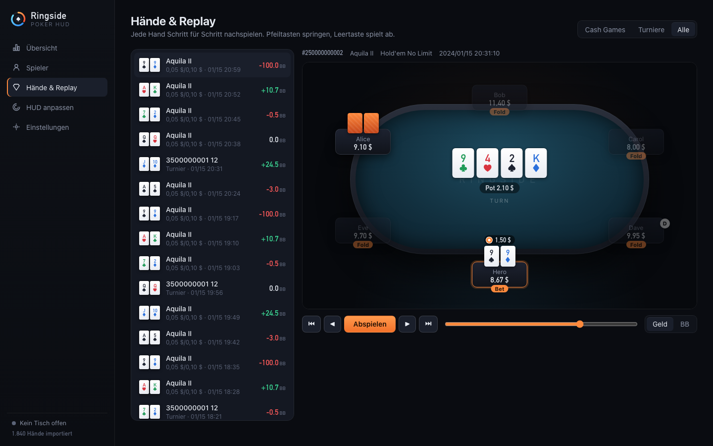

<p align="center"></p>

<h1 align="center">Ringside</h1>

<p align="center">Lokaler Poker-HUD und Tracker für PokerStars unter Windows – mit Ring-Overlay im Stil des früheren Jivaro.</p>


## Was es kann

**Am Tisch**
- **Zwei Overlay-Modi:** *Grafisch* legt eine Platte über das Namensschild von PokerStars (Name, Stack in BB, drei große Werte) und einen Ring aus vier Segmenten um den Avatar, die sich je nach Wert füllen. Ein Klick auf die Platte blättert zu den nächsten drei Werten. *Klassisch* zeigt eine verschiebbare Textbox pro Spieler mit Presets – „Klartext“ schreibt die Werte in Worten aus („spielt 24 % · erhöht 18 %“).
- **Rückblick:** Nach jeder Hand bleiben Board, gezeigte Karten und Gewinner ein paar Sekunden stehen, je Spieler verschiebbar.
- **Notizfarben** aus PokerStars als Rahmen um die Platte, **Bounties** in Knockout-Turnieren auf jeder Platte.
- **Eigene Werte** auf Wunsch nur aus dem laufenden Turnier.
- **Mehrere Tische**, jede Größe und Fensterform: Positionen werden je Tischgröße gespeichert und passen sich jedem Fenster an.

**In der App**
- Übersicht mit Gewinnkurve (gesamt, mit und ohne Showdown, All-in-EV), Winrate, Bounties, Glück bei All-ins und deinem Spielstil.
- Statistik: Ergebnis nach Position, 13×13-Starthand-Matrix, Sitzungen.
- Leaks: deine Werte je Position und Stacktiefe neben veröffentlichten Richtwerten (mit Quelle), mit Sicherheit je Befund und direktem Weg zu den Händen, zur Erklärung und zur Übung.
- Turniere: Buy-ins, Preisgeld, Bounties, ROI und ITM je Währung. Ein Klick öffnet den *Turnier-Bericht* – ohne KI, ohne Internet, aus Ringsides eigenen Zahlen: Ergebnis gegen All-in-EV (Glück oder Pech), Anteil guter Entscheidungen und EV-Verlust je 100 Entscheidungen gegen deinen Schnitt, wo du verlierst (Spot-Art, Position, Straße, Stacktiefe), die drei teuersten Fehler und besten Entscheidungen zum Abspielen, deine Starthände, der Stack-Verlauf und was du als Nächstes übst. Nach der automatischen Analyse führt der Hinweis direkt zum Bericht des fertigen Turniers.
- Live-Tische: deine Gegner an allen offenen Tischen mit HUD-Werten und PokerStars-Notizen.
- Spieler mit Detailansicht und allen Händen, die sie gezeigt haben.
- Hände mit Filtern und Replayer. *Hand-Analyse:* ein Klick bewertet deine ganze Historie oder eine einzelne Hand – jede deiner Entscheidungen bekommt eine Stufe von „beste Wahl“ bis „grober Fehler“ (dieselben Stufen wie in „Hände spielen“), den EV-Verlust in BB und einen Satz zum Warum. Jede Bewertung nennt ihre Quelle: Gleichgewicht, Solver, Modell (auch Limps und Tische mit 2–5 Spielern) oder – für Multiway-Pots und alles andere – eine *Einschätzung* mit gemessener Verlässlichkeit. Die Liste startet mit deinen teuersten Fehlern; im Replayer markiert die Zeitleiste jede Entscheidung.
- Aufgaben-Zentrale: alles, was länger rechnet (Solver, Analyse, Bibliothek, Coach), läuft im Hintergrund weiter, zeigt Fortschritt und Restzeit und lässt sich jederzeit abbrechen.
- HUD-Editor: Panels direkt auf einem eigenen PokerStars-Screenshot ausrichten, Profile als JSON exportieren und importieren.

**Lernen** (gesperrt, solange PokerStars läuft)
- *Heute:* kurze Sitzungen aus fälligen Wiederholungen und neuen Aufgaben, mit Wochenziel.
- *Lernpfad:* elf Einheiten von den Grundlagen bis ICM, mit Kompetenzstufe je Fertigkeit.
- *Deine Hände:* eigene All-ins und Push/Fold-Spots noch einmal entscheiden – danach EV, Ergebnis und Glück in BB.
- *Trainer:* Outs, Pot Odds, Equity, Kombos, Push/Fold aus jeder Position an Tischen mit 2–9 Spielern und mehr, in drei Stufen. Jede Antwort rechnet Ringsides eigene Engine nach.
- *Deine Schwachstellen:* Themen aus den Coach-Berichten fließen in die tägliche Auswahl ein.
- *Charts:* Push/Fold-Gleichgewicht für 2–9 Spieler, jede Position, Shove oder Call gegen Shove, ohne Ante, mit Ante oder BB-Ante (720 Tabellen vorgerechnet, alles andere live). Dazu Preflop-Charts für 15–100 BB an Tischen mit 2–9 Spielern mit Open, 3-Bet, 4-Bet und All-in – als *Modell*, weil das Spiel nach dem Flop über Equity-Realisierung geschätzt wird.
- *Hände spielen:* endlos zufällige, ganze Hände an Tischen mit 2–9 Spielern. Die Gegner spielen nach dem Modell bzw. der Lösung, du bekommst nach jedem Zug eine Bewertung mit Begründung, dazu Session-Statistik, „Hand wiederholen“ und „Tipp anzeigen“. Postflop-Spots rechnet Ringside im Hintergrund voraus.
- *Solver:* Spot am Tisch aufbauen (Positionen anklicken, Ranges aus dem Preflop-Modell), lösen, Zug um Zug durchspielen und gegen die Lösung üben. Eigene Einsatzgrößen lassen sich nachrechnen. Lösungen bleiben unter „Meine Lösungen“ gespeichert. „Diesen Spot lösen“ im Replayer übernimmt Board, Pot und Stack einer Hand.
- *Bibliothek:* häufige Postflop-Spots über eine repräsentative Flop-Auswahl, als signiertes Paket geladen oder im Leerlauf selbst gerechnet und über Ringside Cloud geteilt.
- *Wissen:* visuelle Erklärseiten wie „Warum C-Bet?“.

**KI-Coach** (optional, mit eigenem [OpenRouter](https://openrouter.ai)-Key)
- *Frag den Coach* im Turnier-Bericht und an jeder bewerteten Hand: Das Sprachmodell bekommt die fertigen Zahlen und erklärt sie in Alltagssprache („Warum ist das ein Fold?“). Zahlen in der Antwort, die nicht von Ringside stammen, werden markiert.
- Bespricht auf Wunsch ein abgeschlossenes Turnier ausführlich und speichert die Besprechung: Gesamteindruck, Spots mit Urteil, bessere Alternative und Schwerpunkte zum Üben.
- Das Sprachmodell rechnet nie selbst. Jede Zahl holt es über Werkzeuge aus Ringsides Engine; jede Zahl zeigt, ob sie berechnet oder geschätzt ist.
- Gegnernamen werden vor dem Senden anonymisiert, vor jedem Lauf siehst du die geschätzten Kosten. Der Key liegt im Windows-Tresor.
- Gründlichkeit wählbar, Fortschritt live. Bei Bubble und Finaltisch rechnet er Push/Fold mit ICM (echte Auszahlungen aus der Turnier-Zusammenfassung oder eine gekennzeichnete Standard-Struktur).

**Unter der Haube:** komplett lokal (SQLite), getestet mit einer Million Händen (Overlay-Abfrage 0,1 ms, unter 100 MB RAM). Eigene Poker-Engine in Rust: exakte Equity, ICM und Push/Fold-Gleichgewicht für 2–9 Spieler (heads-up identisch mit HoldemResources, 3-handed auf einen Prozentpunkt bei Ganzfried & Sandholm 2008).

**Internet:** „Nach Updates suchen“, der KI-Coach, wenn du ihn nutzt, und *Ringside Cloud*: Selbst gerechnete Push/Fold-Lösungen werden geteilt und fertige abgerufen – nur Rechen-Eingaben und Ergebnisse, nichts Persönliches. Geteilte Lösungen sind sofort für alle verfügbar: Ringside prüft ihren Aufbau, rechnet Push/Fold vor der Nutzung nach und lässt Stichproben stündlich neu rechnen; fällt eine durch, werden alle Lösungen dieses Absenders zurückgezogen. Standardmäßig an, in den Einstellungen abschaltbar; solange PokerStars läuft, ist die Cloud still.

| Grafisch | Klassisch („Klartext“) |
| --- | --- |
|  |  |

| Übersicht | Statistik |
| --- | --- |
|  |  |

| Turniere | Live-Tische |
| --- | --- |
|  |  |

| Lernen | Trainer |
| --- | --- |
|  |  |

**KI-Coach**



| Replayer | HUD-Editor |
| --- | --- |
|  |  |

## Installation

1. Unter [Releases](https://github.com/ibimspumo/ringside/releases/latest) `Ringside_…_x64-setup.exe` laden und ausführen.
2. In PokerStars **Einstellungen → Spielhistorie** das Speichern der Hand-Histories einschalten.
3. Ringside starten. Die Ordner unter `%LOCALAPPDATA%\PokerStars*\HandHistory` werden automatisch gefunden, sonst unter *Einstellungen* hinzufügen.

Updates: *Einstellungen → Nach Updates suchen*. Updates sind signiert und kommen aus den GitHub-Releases dieses Repos.

## PokerStars-Regeln

PokerStars erlaubt HUDs, die nur Zahlen aus deinen eigenen Händen zeigen. Ringside hält sich an die bekannten Einschränkungen: höchstens drei Farben je Wert, keine Spieler-Etiketten, keine situationsabhängigen Werte, kein Data-Mining, keine Echtzeit-Ratschläge. Die Regeln können sich ändern – prüfe die aktuelle [Third-Party-Tools-Seite](https://www.pokerstars.com/poker/room/prohibited/) für dein Land. Nutzung auf eigene Verantwortung.

## Eigene Layouts als Standard

Im HUD-Editor *Profil → Exportieren* erzeugt eine JSON-Datei mit Darstellung und allen Positionen. Ersetzt man damit `src-tauri/defaults/profile.json`, wird sie mit dem nächsten Release zum Standard für alle.

## Entwicklung

Voraussetzungen: Rust (siehe `rust-toolchain.toml`), Node 22, pnpm.

```sh
pnpm install
pnpm tauri dev                  # App starten (Tisch-Erkennung nur unter Windows)
pnpm dev                        # UI im Browser mit Beispieldaten: /?tab=reports, /?view=overlay&mode=classic, /?view=overlay&recap=1
cargo test --workspace          # Parser, Statistiken, Datenbank, Import
RINGSIDE_SCALE_HANDS=1000000 cargo test --release -p ringside-core --test scale -- --ignored --nocapture
```

- `crates/ringside-core` – Hand-History-Parser, Statistik-Zähler, Positionen, SQLite mit laufenden Summen und fortsetzbarem Upgrade, inkrementeller Import, Tisch-Layouts.
- `crates/ringside-engine` – Equity, ICM, Push/Fold-Gleichgewicht und Preflop-Modell.
- `crates/ringside-solver` – Heads-up-Postflop-Solver: Spot aus Ranges und Einsatzgrößen, Speicherschätzung, Lösen mit Fortschritt und Abbruch, Navigation durch den Baum, Spot-Bibliothek. Rechnet mit `crates/postflop-solver` (Kopie von b-inary/postflop-solver, AGPL).
- `crates/ringside-analysis`, `ringside-play`, `ringside-learn`, `ringside-coach` – Hand-Analyse, „Hände spielen“, Lernbereich und KI-Coach.
- `crates/ringside-cloud`, `ringside-store` – Ringside Cloud (Client und Betreiber-Werkzeuge) und gespeicherte Lösungen.
- `server` – Edge-Script der Cloud-API (Deno).
- `src-tauri` – Tauri-App: Import-Thread, Tisch-Erkennung (Win32), Overlay-Fenster, Einstellungen und Profile, Updater.
- `src` – Svelte-Oberfläche: Overlay (`src/lib/hud`) und Statistik-App (`src/lib/app`).

## Release

Version in `package.json` und `Cargo.toml` erhöhen, committen, taggen, pushen:

```sh
git tag vX.Y.Z && git push origin main --tags
```

Der Workflow baut den Windows-Installer, signiert das Update und veröffentlicht `latest.json`. Er braucht das Repo-Secret `TAURI_SIGNING_PRIVATE_KEY`.

## Lizenz

Ringside steht unter der GNU Affero General Public License, Version 3 oder neuer (AGPL-3.0-or-later, siehe `LICENSE`). Versionen bis 0.5.0 sind unter MIT erschienen und bleiben es.

**Warum AGPL:** Der Postflop-Solver nutzt [postflop-solver](https://github.com/b-inary/postflop-solver) von Wataru Inariba, das unter der AGPL steht. Ein eigener Solver auf diesem Niveau wäre ein Projekt für sich. Wer AGPL-Code einbaut, muss das ganze Programm unter die AGPL stellen. Eine Kopie liegt in `crates/postflop-solver`; Herkunft, Commit und Änderungen stehen in dessen `Cargo.toml`.

**Was das bedeutet:** Für die Nutzung ändert sich nichts – Ringside bleibt kostenlos und läuft lokal. Wer Ringside verändert und weitergibt, muss den vollständigen Quellcode seiner Fassung unter derselben Lizenz mitgeben. Das gilt auch, wenn eine veränderte Fassung über ein Netzwerk angeboten wird, etwa als Web-Dienst. Forks können also nicht mehr geschlossen oder unter einer freizügigeren Lizenz weitergegeben werden.
