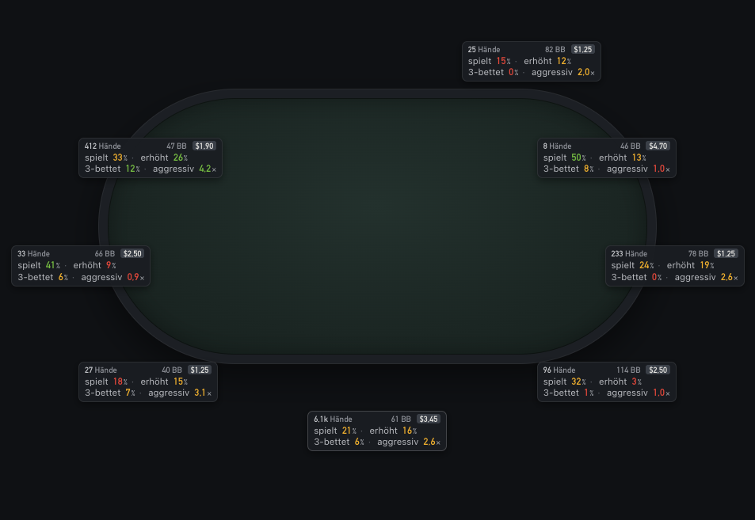
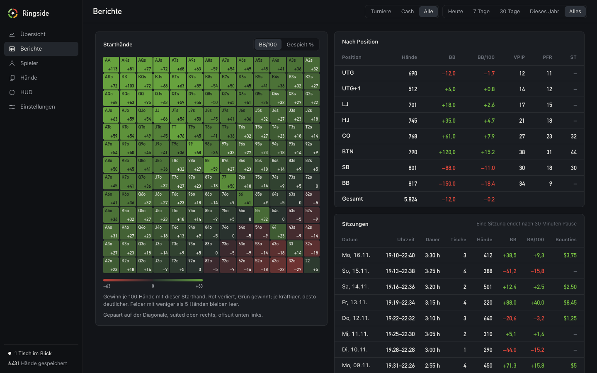
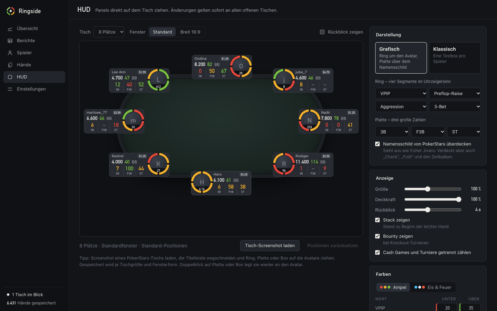

<p align="center"></p>

<h1 align="center">Ringside</h1>

<p align="center">Lokaler Poker-HUD und Tracker für PokerStars unter Windows – mit Ring-Overlay im Stil des früheren Jivaro.</p>


## Was es kann

**Am Tisch**
- **Zwei Overlay-Modi:** *Grafisch* legt eine Platte über das Namensschild von PokerStars (Name, Stack in BB, drei große Werte) und einen Ring aus vier farbigen Segmenten um den Avatar. *Klassisch* zeigt eine verschiebbare Textbox pro Spieler mit Presets – „Klartext“ schreibt die Werte in Worten aus („spielt 24 % · erhöht 18 %“).
- **Rückblick:** Nach jeder Hand bleiben Board, gezeigte Karten und Gewinner ein paar Sekunden stehen.
- **Bounties** in Knockout-Turnieren auf jeder Platte.
- **Mehrere Tische**, jede Größe und Fensterform: Positionen werden je Tischgröße und Seitenverhältnis gespeichert und skalieren mit.

**In der App**
- Übersicht mit Gewinnkurve (gesamt, mit und ohne Showdown), Winrate und Bounties.
- Berichte: Ergebnis nach Position, 13×13-Starthand-Matrix, Sitzungen.
- Spieler mit Detailansicht und allen Händen, die sie gezeigt haben.
- Hände mit Filtern und Replayer.
- HUD-Editor: Panels direkt auf einem eigenen PokerStars-Screenshot ausrichten, Profile als JSON exportieren und importieren.

**Unter der Haube:** komplett lokal (SQLite), getestet mit einer Million Händen (Overlay-Abfrage 0,1 ms, unter 100 MB RAM). Internet nur für „Nach Updates suchen“.

| Grafisch | Klassisch („Klartext“) |
| --- | --- |
|  |  |

| Übersicht | Berichte |
| --- | --- |
|  |  |

| Replayer | HUD-Editor |
| --- | --- |
|  |  |

## Installation

1. Unter [Releases](https://github.com/ibimspumo/ringside/releases/latest) `Ringside_…_x64-setup.exe` laden und ausführen.
2. In PokerStars **Einstellungen → Spielhistorie** das Speichern der Hand-Histories einschalten.
3. Ringside starten. Die Ordner unter `%LOCALAPPDATA%\PokerStars*\HandHistory` werden automatisch gefunden, sonst unter *Einstellungen* hinzufügen.

Updates: *Einstellungen → Nach Updates suchen*. Updates sind signiert und kommen aus den GitHub-Releases dieses Repos.

## PokerStars-Regeln

PokerStars erlaubt HUDs, die nur Zahlen aus deinen eigenen Händen zeigen. Ringside hält sich an die bekannten Einschränkungen: höchstens drei Farben je Wert, keine Spieler-Etiketten, keine situationsabhängigen Werte, kein Data-Mining, keine Echtzeit-Ratschläge. Die Regeln können sich ändern – prüfe die aktuelle [Third-Party-Tools-Seite](https://www.pokerstars.com/poker/room/prohibited/) für dein Land. Nutzung auf eigene Verantwortung.

## Eigene Layouts als Standard

Im HUD-Editor *Profil → Exportieren* erzeugt eine JSON-Datei mit Darstellung und allen Positionen. Ersetzt man damit `src-tauri/defaults/profile.json`, wird sie mit dem nächsten Release zum Standard für alle.

## Entwicklung

Voraussetzungen: Rust (siehe `rust-toolchain.toml`), Node 22, pnpm.

```sh
pnpm install
pnpm tauri dev                  # App starten (Tisch-Erkennung nur unter Windows)
pnpm dev                        # UI im Browser mit Beispieldaten: /?tab=reports, /?view=overlay&mode=classic, /?view=overlay&recap=1
cargo test --workspace          # Parser, Statistiken, Datenbank, Import
RINGSIDE_SCALE_HANDS=1000000 cargo test --release -p ringside-core --test scale -- --ignored --nocapture
```

- `crates/ringside-core` – Hand-History-Parser, Statistik-Zähler, Positionen, SQLite mit laufenden Summen und fortsetzbarem Upgrade, inkrementeller Import, Tisch-Layouts.
- `src-tauri` – Tauri-App: Import-Thread, Tisch-Erkennung (Win32), Overlay-Fenster, Einstellungen und Profile, Updater.
- `src` – Svelte-Oberfläche: Overlay (`src/lib/hud`) und Statistik-App (`src/lib/app`).

## Release

Version in `package.json` erhöhen, committen, taggen, pushen:

```sh
git tag v0.2.0 && git push origin main --tags
```

Der Workflow baut den Windows-Installer, signiert das Update und veröffentlicht `latest.json`. Er braucht das Repo-Secret `TAURI_SIGNING_PRIVATE_KEY`.

## Lizenz

MIT
