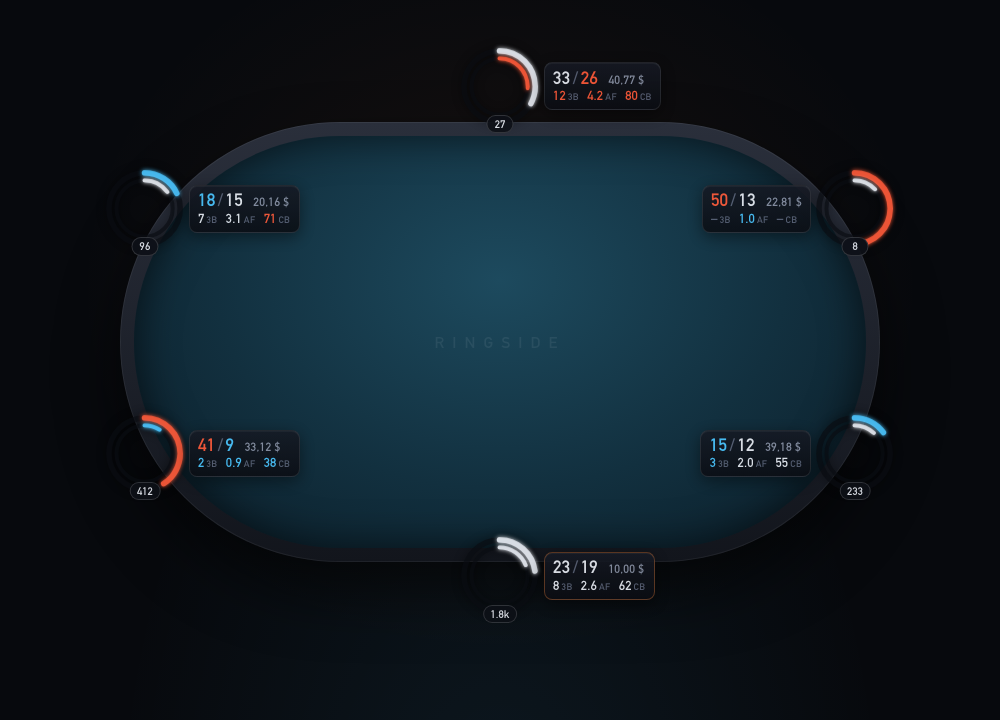

<p align="center"></p>

<h1 align="center">Ringside</h1>

<p align="center">Ein schlanker, lokaler Poker-HUD für PokerStars unter Windows – im Stil der Ring-HUDs à la Jivaro.</p>



## Was es kann

- **Overlay direkt am Tisch**: ein Ring um jeden Avatar (außen VPIP, innen PFR), darunter die Zahl der Hände, daneben eine kleine Karte mit bis zu vier frei wählbaren Werten. Ein Klick öffnet alle Werte, per Drag verschiebst du ein Panel.
- **Mehrere Tische gleichzeitig**: jeder PokerStars-Tisch bekommt sein eigenes Overlay, das beim Verschieben und Größer-/Kleinerziehen mitwandert und mitskaliert. Cash Games und Turniere (Stack in BB).
- **Nur die Basics, dafür sauber**: VPIP, PFR, 3-Bet, Fold auf 3-Bet, Steal, Fold auf Steal, C-Bet, Fold auf C-Bet, WTSD, W$SD, AF, AFq.
- **Statistik-App** mit Gewinnkurve, Spielerliste und **Hand-Replayer** zum Schritt-für-Schritt-Nachspielen.
- **Komplett lokal**: liest die Hand-History-Dateien von PokerStars, speichert alles in einer SQLite-Datei auf deinem PC. Internet nur für „Nach Updates suchen“.

| Hand-Replayer | HUD anpassen |
| --- | --- |
|  |  |

## Installation

1. Unter [Releases](https://github.com/ibimspumo/ringside/releases/latest) die Datei `Ringside_…_x64-setup.exe` laden und ausführen.
2. In PokerStars **Einstellungen → Spielhistorie** das Speichern der Hand-Histories aktivieren.
3. Ringside starten. Die Ordner unter `%LOCALAPPDATA%\PokerStars*\HandHistory` werden automatisch gefunden, sonst unter *Einstellungen* selbst hinzufügen.

Updates: *Einstellungen → Nach Updates suchen*. Updates sind signiert und kommen aus den GitHub-Releases dieses Repos.

## PokerStars-Regeln

PokerStars erlaubt HUDs, die nur Zahlen aus deinen eigenen Händen zeigen. Ringside hält sich bewusst an die bekannten Einschränkungen: höchstens drei Farben je Wert, keine Spieler-Etiketten, keine situationsabhängigen Werte, kein Data-Mining, keine Echtzeit-Ratschläge. Die Regeln können sich ändern – prüfe vor dem Spielen die aktuelle [Third-Party-Tools-Seite](https://www.pokerstars.com/poker/room/prohibited/) für dein Land. Die Nutzung erfolgt auf eigene Verantwortung.

## Entwicklung

Voraussetzungen: Rust (stable), Node 22, pnpm.

```sh
pnpm install
pnpm tauri dev                  # App starten (Overlay-Tracking nur unter Windows)
pnpm dev                        # UI im Browser mit Beispieldaten, z. B. /?view=overlay oder /?tab=hands
cargo test --workspace          # Parser, Statistiken, Import
```

Aufbau:

- `crates/ringside-core` – Hand-History-Parser, Statistik-Zähler, SQLite-Datenbank, inkrementeller Import. Plattformunabhängig und getestet.
- `src-tauri` – Tauri-App: Import-Thread, Fenster-Tracking der Tische (Win32), Overlay-Fenster, Updater.
- `src` – Svelte-Oberfläche: Overlay (`?view=overlay`) und Statistik-App.

## Release

Version in `package.json` erhöhen, committen, Tag setzen und pushen:

```sh
git tag v0.2.0 && git push origin main --tags
```

Der Workflow baut den Windows-Installer, signiert das Update und veröffentlicht `latest.json` für den Updater. Er braucht das Repo-Secret `TAURI_SIGNING_PRIVATE_KEY` (Inhalt des privaten Schlüssels, dessen öffentlicher Teil in `src-tauri/tauri.conf.json` steht).

## Lizenz

MIT
